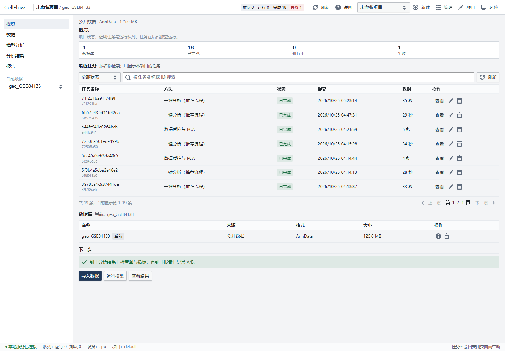
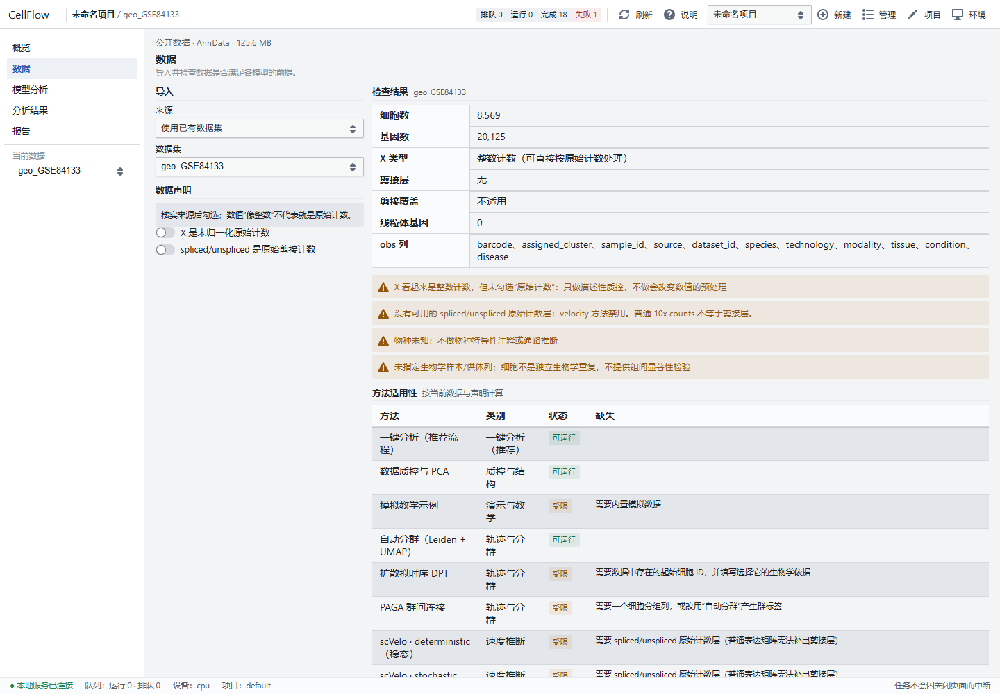
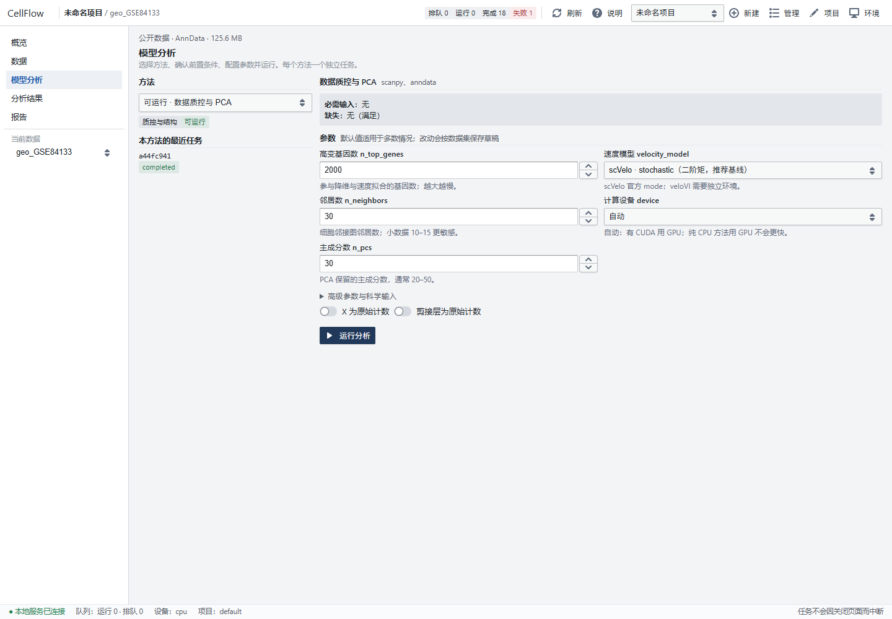
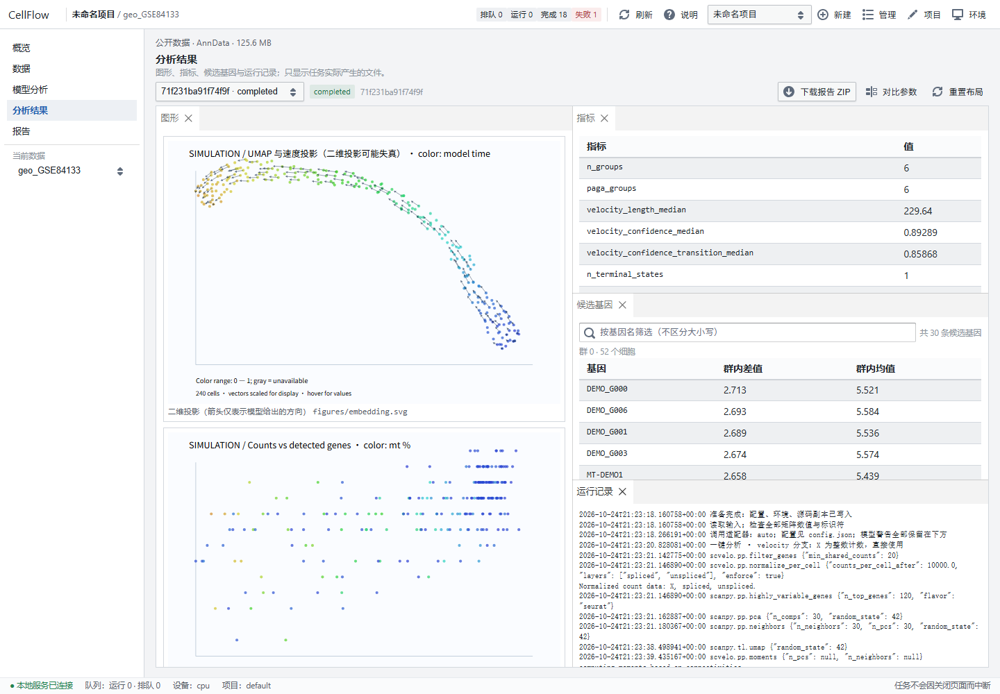

# CellFlow · 本地单细胞动力学工作台

仓库：<https://github.com/yangfang041225/CellFlow> ｜ License: [MIT](LICENSE)

面向**非程序员研究者**的中文桌面工具：导入 scRNA-seq 数据 → 检查格式与质量 → 判断哪些方法在当前数据上合法可用 →
按建议配置调用模型 → 展示图形与指标 → 导出两份中文报告。

- **界面**：概览 / 数据 / 模型分析 / 分析结果 / 报告；Qt 原生窗口，无浏览器地址栏。
- **默认纯 CPU**：适合 i5-1240P / 16 GB / Intel 核显 / 无 NVIDIA 的机器，不需要 CUDA。
- **数据不出本机**：没有云端大模型、没有 API 密钥、不上传数据。
- **可断网分析**：依赖装好、数据齐备后，计算、出图、报告全部离线完成；只有安装依赖和点击官方文档需要联网。

> 本仓库自带的数据是**明确标记的模拟数据**（240 细胞 × 120 虚构基因），只用于验证软件流程，**不是生物学发现**。

---

## 快速开始

> **默认入口只有一个：Qt 原生桌面窗口（`cellflow_app.pyw`）。** 不弹浏览器、不保留黑色命令行窗口。
> Streamlit 与 legacy 入口只作历史兼容，支持边界见本节末尾。

1. 先完成一次安装与自检（见下一节）：`python install.py --check` 输出 `ENVIRONMENT_CHECK_OK`。
2. 启动主入口（任选其一）：
   - 双击桌面快捷方式 **CellFlow**（如果有；目标为 `.venv\Scripts\pythonw.exe`，参数 `cellflow_app.pyw`，起始位置为项目根目录）；
   - 或在项目目录打开 PowerShell 执行：

     ```powershell
     .venv\Scripts\pythonw.exe cellflow_app.pyw
     ```

   `pythonw.exe` 是 GUI 子系统，不会弹控制台；窗口关闭后本机 API 会停止。
   启动日志在 `logs/app.log`，失败详情在 `logs/app-error.log`（诊断时也可用
   `.venv\Scripts\python.exe cellflow_app.pyw` 保留窗口看报错）。
3. 窗口打开后按左侧顺序使用：**概览 → 数据 → 模型分析 → 分析结果 → 报告**；每页右上角有帮助说明。
4. 在「数据」页选择数据来源：上传文件 / 本机路径 / 下载公开数据（需联网）。
   没有自己的数据时，先用「下载公开数据」拉一个 GEO 或 CELLxGENE 数据集；
   内置模拟示例已从正式界面移除（只在测试与 API 层保留，见 `docs/test_report.md`）。
5. 在「模型分析」页选方法卡（第一次建议选 **一键分析（推荐）**）、核对数据体检与参数，
   点 **运行分析**；到「分析结果」页刷新，就能看到图形、指标与报告。
6. 有真实数据时上传 `.h5ad`（窗口内上传 ≤1024 MiB；本机文件可直接放到磁盘上让程序读，≤4 GB）。
   **只有一个 `.h5ad` 也能跑**：
   程序会先体检，有剪接层就加速度与命运，没有就只做质控/分群/轨迹，并说明原因。

### 历史入口与支持边界（不作为默认）

| 入口 | 启动方式 | 现状 | 支持边界 |
|---|---|---|---|
| **Qt 主入口** | `pythonw cellflow_app.pyw` / 桌面快捷方式 | **唯一默认入口** | 新功能只在这里；React 前端 + FastAPI + Qt 窗口 |
| Streamlit 回退 | `.venv\Scripts\python.exe launch.py` | 历史回退入口，端口 8501–8504，保留控制台 | 只保证 `tests/test_ui_smoke.py` 的冒烟渲染；可能落后于 Qt 界面；科学引擎相同，不删 |
| `legacy_ui/` | 不启动 | 已从应用移除的旧界面模块 | 仅存档，不被引用，不维护 |
| `legacy_launchers/` | `启动工作台.cmd` / `.vbs` | 旧静默启动包装器 | 仅作历史记录（移入子目录后路径已不适配当前根目录）；新用户请用上面的 Qt 主入口 |

Streamlit 入口的代码是 `app.py` + `cellflow/studio/`；它仍读取同一套任务队列与结果，但**不是**发布主路径。
如果你只需要用这个工具，不需要安装或启动 Streamlit。

---

## 界面预览（本机实拍）

| 概览 | 数据 |
|---|---|
|  |  |

| 模型分析 | 分析结果 |
|---|---|
|  |  |

截图由本机 Edge 无头模式对本工具真实页面拍摄（1440px 宽）；文字随窗口宽度自适应。

### 主流 RNA velocity 模型切换 + 计算设备

「模型分析」页有一张**模型下拉**和一个**设备下拉**（对一键分析生效）：

| 模型 | 背后实现 | 速度 | 设备 | 状态 |
|---|---|---|---|---|
| `deterministic`（稳态） | scVelo 官方 `mode='deterministic'` | 最快 | CPU | 可运行 |
| `stochastic`（二阶矩，默认） | scVelo 官方 `mode='stochastic'` | 中等 | CPU | 可运行 |
| `dynamical`（完整动力学） | scVelo 官方 `mode='dynamical'` | 最慢 | CPU | 可运行 |
| `veloVI`（变分 + 不确定性） | scvi-tools 官方 `VELOVI` | 慢 | **CPU / GPU 都可** | 独立环境 `.venv-velovi` |

**切换模型 = 切换上游官方实现**，不是本程序自写算法；不同模型的输出都会转成同一套结果结构
（速度矩阵、箭头投影、时间/排序、指标、候选基因、限制说明），界面的「分析结果」页按同一套读。

**计算设备**：`自动 / CPU / GPU（CUDA）`。

- 自动：检测到可用的 PyTorch + CUDA 就用 GPU，否则用 CPU；
- 选 GPU 但环境不满足时，会**明确说原因**并回退 CPU，不会假装跑在 GPU 上；
- 神经网络类方法（veloVI、RegVelo，将来的 DeepVelo/UniTVelo/VeloAE）真正能吃到 GPU；
  scVelo / scanpy / CellRank 这部分是 CPU 实现，选 GPU 也不会更快——界面会写清楚；
- 连接课题组服务器时：把项目放上去、装好 CUDA 版 PyTorch，界面选「自动」或「GPU」即可；
  也可以用环境变量固定：`set CELLFLOW_DEVICE=cuda`。

### 隔离环境（不同模型依赖不兼容时的做法）

有些模型对依赖版本要求严格（例如 scvi-tools 1.2 要求 `numpy<2`，与主环境冲突），
所以按模型分环境，队列会**自动用对应解释器**运行该任务：

| 环境 | 内容 | 安装命令 |
|---|---|---|
| `.venv`（主） | 界面 + scanpy/scVelo/CellRank | `python install.py` |
| `.venv-velovi` | veloVI（scvi-tools 1.2 + CPU PyTorch 2.5.1） | `python install.py --include-velovi` |
| `.venv-regvelo` | RegVelo 0.4.2（未安装） | `python install.py --include-regvelo` |

程序只把「已安装且已锁定版本」的环境标记为可运行；没装的会明确显示「尚未接入/实验接入」，不会偷偷换模型。

### 通用数据导入（不用关心格式和方向）

| 你手上的东西 | 能不能直接拖进来 |
|---|---|
| `.h5ad`（AnnData） | ✅ |
| `.loom`（velocyto 输出，带 spliced/unspliced 更好） | ✅ |
| 10x 的 `.h5`，或 `matrix.mtx + barcodes + features` 目录 | ✅（目录可填「本机路径」） |
| CSV / TSV 表达表（含 `.gz`） | ✅ 自动识别元数据列 |
| 上面任意格式打成的 `.zip` / `.tar.gz` | ✅ |

**矩阵方向自动判断**：行是细胞还是基因、名字像条码还是基因符号，程序自己看；
必要时自动转置，并把“做过什么”写进报告。


## 界面风格（朴实版，桌面窗口）

五个页面统一成一套设计系统：白底、灰线、方角、无阴影；只保留一个深蓝色用于强调；数据用表格排版。

- 概览：项目与任务状态、数据入口、帮助说明；
- 数据：来源选择（上传 / 本机路径 / 公开下载）、体检与详情；
- 模型分析：方法卡、前置条件与参数，按钮置灰时写明缺什么；
- 分析结果：概览 / 图形 / 指标 / 基因 / 日志 / 质量；
- 报告：A/B 报告、HTML/PDF、结果 ZIP。

截图见 docs/screenshots/（React 工作站：概览/数据/模型/结果/报告）。

---

## 安装

只需要做一次。在项目目录打开 PowerShell：

```powershell
python install.py --check            # 只读自检：真实 import + 版本，输出 MANIFEST_JSON
python install.py                    # 基础环境：界面 + 质控/轨迹/速度（先跑这个即可）
python install.py --include-cellrank # 可选：再加 CellRank 2（下游命运概率，纯 CPU，体积小）
python install.py --include-velovi   # 可选：veloVI 独立环境（scvi-tools + CPU PyTorch）
python install.py --include-regvelo  # 可选：RegVelo 独立神经环境（下载数 GB，本机不推荐）
```

`--check` 会用 `.venv` 与 `.venv-velovi` 各自的解释器真实 `import` 并核对版本；
缺包、版本不符、隔离环境损坏都会判为 `not_ready`，不再“看到 exe 就算就绪”。
完整字段、可重复安装输入与回滚步骤见 [安装与环境 Manifest](docs/install_manifest.md)。

国内网络慢时只对本次进程换镜像，不改全局设置：

```powershell
$env:UV_DEFAULT_INDEX = 'https://pypi.tuna.tsinghua.edu.cn/simple'
python install.py
```

安装结果写入 `installation.json`，解析后的完整版本写入 `environment-venv.lock.txt`。
**安装成功不等于分析验证通过**：验证记录见 [验证记录.md](验证记录.md)。

### 前端构建（仓库不提交 web/dist）

前端源码在 web/，构建产物被 .gitignore 排除。首次使用或改过前端后执行：

```powershell
cd web
npm ci
npm run build
```

生成 `web/dist/` 后，Qt 主入口与本地 API 才能提供界面（缺少时会明确提示“请先构建前端”）。
需要 Node 18+（开发环境实测 Node 26 / npm 11，CI 使用 Node 22）。

---

## 五个页面

| 页面 | 作用 | 会不会提交任务 |
|---|---|---|
| 概览 | 项目状态、最近任务、数据与结果入口；页面帮助 | 不会 |
| 数据 | 上传 / 本机路径 / 公开数据下载；数据体检与详情 | 不会 |
| 模型分析 | 方法卡、科学准入、参数与资源说明；点「运行分析」提交 | **只有点按钮才提交** |
| 分析结果 | 任务状态、图形、指标、候选基因、日志、质量校验 | 不会 |
| 报告 | A/B 报告预览、HTML/PDF、结果 ZIP 下载 | 不会 |

---

## 当前方法接入状态

共 **17 个方法条目**，分 7 类用途：**一键分析**、演示与教学、质控与结构、轨迹与分群、速度推断、调控动力学、下游命运分析。

| 状态 | 方法 | 说明 |
|---|---|---|
| **可运行（11）** | **一键分析**、质控/PCA、模拟示例（仅 API/测试）、**自动分群 Leiden+UMAP**、**DPT**、**PAGA**、**scVelo deterministic**、**scVelo stochastic**、**scVelo dynamical**、**CellRank 2 命运概率**、**veloVI**（独立环境） | 真实调用上游库；在本机 CPU 上用模拟数据与一份真实 velocity 数据集端到端跑通 |
| **实验接入（1）** | RegVelo 0.4.2 | 适配器已写好，但本机**未安装**独立环境、**未训练**；CPU 方案不输出调控边（官方 `inferred_grn` 写死 CUDA） |
| **尚未接入（5）** | DeepVelo、UniTVelo、VeloAE、dynamo、MultiVelo | 只有方法注册与中文说明，**没有可调用代码**；界面会明确拦截，不会偷偷替换成别的模型 |

### 一键分析（本期新增，默认开启）

丢一个 `.h5ad` 进去，一次跑完并只产出**一份汇总报告 + 全套图**：

```
数据体检 → 质控 → 自动分群(Leiden+UMAP) → PAGA 群间连接
        →（有 spliced/unspliced）scVelo 速度 + 箭头 + 速度伪时序
        →（有速度或给了起点）CellRank 终末状态 + 命运概率 + 驱动基因候选
        → A 生物学报告 + B 技术复现报告
```

- **不需要你填起点**：有速度时用速度图作核（VelocityKernel）；给了起点则额外用 DPT 拟时序作核。
- **没有剪接层时不会硬凑速度**，没有起点时不会硬凑方向，每一步的限制都写进报告。
- 在「模型分析」选择 **一键分析（推荐）** 方法卡；想单独跑某个方法，改选对应方法卡。

### 输入判定的改进（真实数据常见形态）

程序现在会先判断 `X` 处于哪种状态，再决定要不要处理：

| X 的状态 | 判断依据 | 处理方式 |
|---|---|---|
| 整数计数 | 全是整数 | CP10k 归一化 + log1p |
| 已取过对数 | 非整数且最大值 < 30 | **不再归一化/取对数**，直接用 |
| 已缩放到人为总量 | 非整数且数值较大 | 只取对数，不再缩放 |

**关键改进**：很多真实 h5ad 的 `X` 已经归一化，但 `spliced/unspliced` 仍是原始计数（velocyto / STARsolo 的输出就是这样）。
旧版本会因为「X 不是整数」直接拦掉 velocity；现在会自动用 `spliced + unspliced` 重建计数矩阵走 scVelo（这是 scVelo 的标准约定），并在报告里写明。

本期新增/补齐的能力：

- **自动分群（Leiden + UMAP）**：用 igraph 后端，不额外引入 `leidenalg`；分组不再强制依赖你事先准备标签。
- **PAGA 支持自动分群 + 方向线索**：没有分组列也能跑；若同时给了起点，会给出“群平均拟时序”作为方向线索（明确标注不是谱系证据）。
- **scVelo 补速度伪时序与一致性诊断**：stochastic 也会产出速度伪时序；dynamical 产出 latent time 与每基因动力学参数。
- **CellRank 2 命运概率**：支持两种核 —— 有速度用 VelocityKernel（**不需要起点**），只有拟时序时用 PseudotimeKernel；
  输出终末状态、每细胞命运概率、驱动基因候选；自动诊断“终末状态落在时序早端”的异常并写进报告。
- **统一输出 schema**：所有方法都产出同一套字段（坐标/时间/指标/基因/边界），界面与报告不需要为每个方法写分支。

### 公开数据下载（h5adify 功能，需联网）

不需要自己找数据：在「数据」页把来源切到 **下载公开数据（需联网）**，可以：

| 来源 | 怎么用 | 说明 |
|---|---|---|
| **GEO（NCBI）** | 填 GSE 编号（如 `GSE84133`），点「下载并转换」 | 自动读 NCBI 补充文件目录 + SOFT 元数据；支持 10x 三件套 / `.h5ad` / `.h5` / CSV 计数表；多物种时只保留细胞数最多的物种并记录被忽略的样本 |
| **CELLxGENE** | 关键词搜索后选数据集，或填 UUID | 走官方 API + 直链 `.h5ad`（本机到该站点网络可能受限，失败会明确提示） |
| **任意 .h5ad 直链** | 粘贴 URL | 直接下载并标准化 |

转换后的数据统一补齐 obs 元数据（`source / dataset_id / sample_id / species / technology /
modality / tissue / condition / disease`），然后**直接进入体检与一键分析**，不需要你手工转换。

命令行也能用：

```powershell
.venv\Scripts\python.exe -m cellflow.cli list-geo --gse GSE84133
.venv\Scripts\python.exe -m cellflow.cli fetch --source geo --id GSE84133 --out data\public
.venv\Scripts\python.exe -m cellflow.cli search --source cellxgene --query pancreas
```

设计参考并改写了 MIT 许可的 [h5adify](https://pypi.org/project/h5adify/)；差异与许可声明见
[第三方代码与许可](docs/第三方代码与许可.md)。下载 **需要联网**，数据只落在本机 `data/public/`，
不会上传任何东西；公开数据的使用条款属于各自数据库，引用前请自行核对。

**“已接入”不等于在你的数据上有效。** 真实数据的有效性取决于实验设计、数据覆盖、批次、模型假设与独立证据。

---

## 数据要求

- `.h5ad`：`X` 为 cells × genes；细胞与基因 ID 唯一，值有限且非负。
- 速度类方法另需 `layers["spliced"]`、`layers["unspliced"]` 原始计数，且与 X 的细胞/基因顺序对齐。
  **普通 10x counts 或 CSV 无法恢复剪接层**，程序不会猜。
- 只有确认过的原始计数才会进入会改变数值的预处理；已 log 化的矩阵只做描述性质控。
- PAGA 的分组列可以为空（用「自动分群」）；DPT / CellRank 需要起始细胞 ID **与生物学依据**。
- RegVelo 需要 TF×target 的 0/1 CSV，并说明物种、方向、基因 ID 版本与训练/测试关系。
- 规模上限：窗口内上传 1024 MiB / 本机文件 4 GB，矩阵合计内存约 3 GB（按内存判断，不死卡元素数）；
  CellRank 额外限制 ≤6000 细胞（GPCCA 需要稠密分解）。

---

## 结果在哪里

```
results/
  queue.sqlite              本地任务队列（跨页面刷新保留）
  inputs/                   提交时的输入副本
  <任务ID>/
    input.h5ad / input.npz  原始副本（不改动你的文件）
    config.json             全部参数
    environment.json        本次解释器真实安装的所有包版本
    format.json             数据格式体检
    validation.json         准入检查
    eligibility.json        每个方法能不能跑、为什么
    qc.json / result.json   质控指标 / 统一结果
    gene_table.json         候选基因与拟合参数
    calls.json              真实调用序列（函数名 + 参数）
    provenance.json         哈希、命令、种子、耗时、状态
    figures/                SVG + 独立 Plotly HTML
    analysis.h5ad           模型结果对象（如产生）
    velocity.npz            基因空间速度（如产生）
    A_生物学分析报告.md      B_技术与复现报告.md
    A_report.html            B_report.html（浏览器可打印成 PDF）
```

界面导出的 ZIP 包含报告、图形与复现记录，**不夹带**原始矩阵和模型权重。报告与日志可能含样本 ID 与本地路径，分享前请检查。

---

## 测试与验证

```powershell
# 环境健康（真实 import + 版本，输出 MANIFEST_JSON）
python install.py --check

# 安装检查回归（临时假环境，不重装）
.venv\Scripts\python.exe -m unittest tests.test_install_checks -v

# 文档本地链接
.venv\Scripts\python.exe tools\check_docs_links.py

# 全部单元/集成测试（较慢）
.venv\Scripts\python.exe -m unittest discover -s tests -v
```

当前记录 **272 个测试**（2026-10-25 21:52 全量运行，见 [测试报告](docs/test_report.md)）；
本次另新增 `tests/test_install_checks.py`（13 项），**未重跑全量**，所以总数未复核。
覆盖范围：

- 数据前提：缺 spliced/unspliced 不会被补成 velocity、稀疏矩阵 NaN 检测、重复 ID 拦截、归一化层不能冒充原始计数、自动分群不作为“缺分组”。
- 方法准入：未接入方法永远不可运行、阻塞原因必须是中文可读原话、配置守卫拒绝未知字段与错误类型。
- 安装/环境：真实 import 与版本检查、隔离环境用自身解释器探测、假环境下的 not ready/ready 判定。
- 端到端（CPU 真实调用）：质控/演示、Leiden 分群、PAGA（自动分群）、scVelo stochastic / dynamical、CellRank 命运概率，以及 RegVelo 的“缺环境 → 明确失败而不是假成功”。
- 报告：A 报告必须包含数据质量/参数解释/证据边界/官方来源；B 报告必须包含环境/超参数/调用序列/复现方式/文件清单。
- 界面：用 Streamlit AppTest 真实渲染回退页面；Qt/React 主入口由构建、截图与人工验收覆盖，没有 DOM 级自动化。

CI 配置在 `.github/workflows/ci.yml`（Windows：requirements + 前端构建 + 文档链接 + install 检查 + 全量测试）。
**本机没有实际在 GitHub Actions 上跑过这份 CI**，见测试报告的“已知测试局限”。

本机实测（240 细胞模拟数据，含解释器启动）：质控约 2 s，Leiden/DPT/PAGA 约 18–20 s，
scVelo stochastic ≈19 s、dynamical ≈23 s，CellRank ≈22 s。真实数据会显著更慢。

---

## 解释与比较规则

- 潜在时间/拟时序 **≠** 真实时间；箭头 **≠** 已验证谱系；候选调控关系 **≠** 因果证据。
- 不同模型的损失、似然与时间尺度**不能互相排名**；本程序不输出“最佳模型”。
- 比较两个任务时，程序只报告**配对方向一致性**，并要求输入哈希、细胞/基因顺序、预处理指纹、关键依赖版本一致；
  不一致时直接说“不可比较”并列出原因。
- 正式评测需按供体/样本预先拆分；特征选择、先验网络、调参与评价标签之间不能泄漏。
- 模拟结果永远标记为模拟；缺少证据的结论保持“未知”。

---

## 仍在限制内的事

- 单用户、单任务并发；没有训练取消、崩溃自动续训、严格内存隔离与多用户认证。
- 界面只绑定 `127.0.0.1`；不提供远程访问。
- 报告是 Markdown + 可打印 HTML，没有原生 Word/PDF 排版。
- 没做细胞类型注释、双细胞校正、环境 RNA 校正、批次校正与组间显著性检验。
- 未接入的可选方法（DeepVelo / UniTVelo / VeloAE / dynamo / MultiVelo）需要各自独立环境与专项适配；veloVI 已在独立环境可运行；
  RegVelo 需要另行安装 CPU 神经环境并实际训练验证。

更多细节：

- [操作手册](docs/操作手册.md)｜[模型介绍（离线版）](docs/模型介绍.md)｜[架构说明](docs/architecture.md)｜[架构与 MVP](docs/架构与MVP.md)
- [安装与环境 Manifest](docs/install_manifest.md)｜[CI 配置](.github/workflows/ci.yml)
- [开源方案调研](docs/open_source_research.md)｜[模型支持矩阵](docs/model_support_matrix.md)｜[数据流水线](docs/data_pipeline.md)
- [测试报告](docs/test_report.md)｜[已知问题](docs/remaining_issues.md)｜[第三方许可证](THIRD_PARTY_NOTICES)
- 本仓库代码采用 [MIT License](LICENSE)；第三方组件许可见 THIRD_PARTY_NOTICES。
- [API 路由](docs/api_surface.md)｜[本机可用能力](docs/local_capability.md)
- [审计落实对照](docs/audit_response.md)｜[交付状态](docs/final_status.md)｜[验收清单](docs/acceptance.md)｜[术语参考表](docs/术语表.md)
- [版本与来源核查](docs/版本与来源核查.md)｜[本机硬件与运行策略](docs/本机硬件与运行策略.md)｜[验证记录](验证记录.md)
