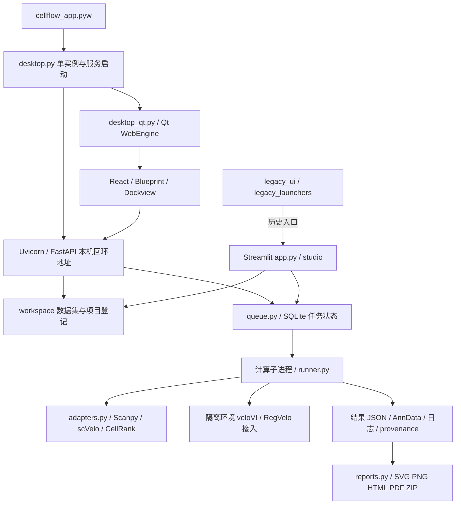

# CellFlow 全面独立工程审查与修改项目书

审查日期：2026-10-25。对象：本机 CellFlow 现有交付目录。本文合并完整审计、问题台账、所有图形的改造规范及开发修改项目书，是本轮唯一正式交付文档。

> 项目路径：`C:\Users\mtgmc\Documents\Codex\2026-10-24\referenced-chatgpt-conversation-this-is-an\outputs\CellFlow`。
> 本轮没有修改生产业务代码。模型测试、上传、任务、导出及界面试验在隔离副本中完成；现有第三方环境被只读复用，没有安装新包或下载模型、大数据集。本文的图形方案是待实施要求，不能理解为现有软件已修好。

## 第一部分：执行摘要

CellFlow 已经具备真实计算、桌面入口、持久任务记录和报告输出的基础，是有工程基础的实验性科研工作台。它不是单纯把脚本摆进界面，但目前也没有达到可以放心交给其他科研人员独立使用的 V1.0。

主要阻碍不是配色。恶意压缩包可以在导入报错前写出解压目录；取消任务后计算子进程仍可能存活；项目登记、跨项目去重、输入方向、模型输入协议、图形语义和导出存在实质缺陷。这些问题会分别影响文件安全、资源占用、项目隔离、结果解释和对外汇报。

界面中的“箭头不好看”有两层原因：其一是当前 SVG 箭头与点坐标没有使用相同的几何变换，方向本身可能失真；其二是图形体系缺乏论文图需要的等比例坐标、密度过滤、清晰图例、稳定配色、版式和输出标准。必须先修正几何和含义，再统一全部图形，不能只把箭头画长、画弯或增加数量。

已有测试共运行 143 项，136 项通过、7 项跳过、0 项失败。另行设计的缺陷探针复现了测试没有覆盖的问题。因此，绿色测试说明已有路径可运行，不能证明产品可靠性或生物学结论正确。独立对照中，同一模拟输入、相同预处理条件下，CellFlow stochastic velocity 与直接调用已安装 scVelo 的结果最大绝对差为 0；这支持该路径的数值接入正确，不支持所有模型和真实数据都正确。

本轮共登记 40 项：P0 1 项、P1 19 项、P2 18 项、P3 2 项。P0 指必须先封堵的安全缺陷；P1 指影响数据、计算、解释或核心操作的发布阻断项；P2 指产品化和维护的重要改进；P3 指后续清理。严重性不等于已经发生真实用户事故，证据类型逐项标注。

## 第二部分：当前架构与功能清单

### 2.1 实际架构

主产品路线是 Qt 外壳加本机 Web 服务，不需要为“专业感”推倒改成另一套桌面框架。Streamlit 和 legacy 路线仍增加理解、测试和维护负担。README 中仍有旧入口与黑窗口相关描述，应明确唯一推荐入口及历史入口的支持状态。

扫描到 72 个 Python 模块、约 14,735 行，另读根入口及前端源码；核心接入集中于较大的 adapters.py，报告和执行模块也承担多种职责。发现 workspace.unregister_dataset 重复定义，后者覆盖前者且造成真实归属错误。存在懒加载依赖环，但本轮未观察到立即导入失败，不把依赖环直接等同于运行故障。目标目录缺少可用 Git 元数据，不能判定其中运行环境、备份和临时目录是否曾被提交。

### 2.2 功能状态

| 功能 | 实际状态 | 证据及边界 |
|---|---|---|
| Qt 启动、隐藏控制台、单实例 | 已实现并实测 | 隔离副本窗口正常；console_hwnd=0；重复启动没有建立第二服务 |
| 项目、数据集登记 | 已实现但有数据归属缺陷 | 删除另一项目的数据登记可使剩余登记降为 default |
| 上传、压缩包、CSV、AnnData | 已实现但输入安全与语义不合格 | 越界解压、轴猜测、空值静默变零、复合扩展名丢失 |
| QC、Leiden、DPT、PAGA | 已接入 | 测试可运行；DPT 表单修改后阻断状态不更新 |
| scVelo deterministic/stochastic/dynamical | 已接入真实上游计算 | 测试通过；stochastic 另有直接数值对照；不代表真实数据收敛验证 |
| auto 综合流程、CellRank | 已接入并有小型端到端运行 | 模拟输入完成；单终末状态时概率接近 1，不能包装成命运区分能力 |
| veloVI | 能运行的接入，输入协议需要重验 | 一轮 smoke 通过；raw S/U 与官方归一化输入协议不一致 |
| RegVelo | 部分实现、未完成运行验证 | 环境缺失；本轮读本地 0.4.2 wheel，未训练；统一输出不完整 |
| DeepVelo、UniTVelo、VeloAE、dynamo、MultiVelo | 规划入口 | 不应在 UI 中暗示已可用 |
| 队列、取消、恢复 | 部分可靠 | SQLite 防止同一任务行重复领取；不提供全局计算上限，取消不覆盖进程树 |
| HTML/PDF/ZIP 报告 | 能生成但不满足交付要求 | PDF 字号缩至约 0.72 pt；ZIP 缺 HTML 所引用 stream.png |
| GPU 服务器、远程执行、多组学 | 尚未形成可验证产品能力 | 本轮未验证服务器、GPU 或这些数据类型 |

方法登记共 17 项，其中 12 项有 implemented 标志，包括 auto、QC、demo 和上述计算路径；该标志不能替代运行环境、输入契约和科学验证。

## 第三部分：前端审计

### 3.1 用户旅程与页面判断

实际走查包括上传模拟 AnnData、声明原始层、尝试 DPT、提交 QC 和 stochastic、查看结果及报告、导出 PDF/ZIP、切换到空项目。QC 约 5 秒完成；本次界面 stochastic 约 19.94 秒完成。这是小模拟数据的观察值，不是性能承诺。

| 页面/环节 | 当前问题 | 应改为什么 | 优先级/成本 |
|---|---|---|---|
| 概览与项目 | 顶栏统计和当前项目范围不完全一致 | 所有计数明确项目范围；点击计数进入相同过滤结果 | P1–P2 / 中 |
| 数据 | 导入名变为哈希；预览统计不准；声明状态可串数据集 | 保留原名，显示细胞×基因、层、稀疏度、来源及转换清单；确认绑定数据内容指纹 | P1 / 中 |
| 模型分析 | 输入框不完整关联 label；根细胞修改后 DPT 仍禁用；模式和参数可冲突 | 用方法 schema 同时生成表单与完整配置校验；每次相关字段变化重新验证 | P1 / 中 |
| 任务 | 日志刷新受状态依赖限制，取消反馈与真实子进程不同步 | 单独增量日志流；取消显示“正在停止”，确认退出才终态 | P1 / 中 |
| 结果 | 图区狭窄，主次不明；切换空项目仍显示旧图 | 先清空旧详情、终止旧请求；主图优先占宽，诊断图分组 | P1–P2 / 中 |
| 报告 | 图重复、解释模板过度断言、导出与预览不一致 | 同一个 FigureSpec 驱动预览/报告/导出，声明实际执行步骤及限制 | P1 / 中–高 |
| 公共数据与下载 | 内存状态、覆盖与项目范围不够清晰 | 持久下载记录，独立目标目录，完成后校验并显式登记 | P2 / 中 |
| 窗口适配 | 980×620 逻辑视口工具区拥挤；没有工作区尺寸钳制 | 窗口按 availableGeometry 定位缩放，窄宽折叠工具栏 | P2 / 中 |

空项目切换的复现同时出现“当前数据集还没有任务”和旧 embedding.svg、qc.svg、stream.png。这是上下文错误，可能让用户把上一项目图当作当前项目结果，优先于美化。

真实原生窗口默认 1180×780、最小 980×620。未实测 125%、150%、200% 系统 DPI；小逻辑视口试验不能冒充这些实测。应补齐双屏、不同缩放、任务栏占用、最小工作区和重启后窗口位置用例。

### 3.2 所有图统一改造规范——修改项目书的必做范围

用户要求的是整套图达到专业论文图的表达水平，不是仅修一张箭头图。参考顶刊图的视觉组织和科学表达，不复制别人的实验数据、结论或原图。

**统一图形契约。** 每张图必须携带 figure_id、数据/任务 ID、细胞与基因范围、坐标来源、颜色字段、单位、模型与投影方法、随机种子、过滤参数和实际限制。没有该字段的数据不得靠标题暗示。前端、报告和导出共用同一 FigureSpec；图生成与文字解释共同读取计算结果，不能各自推测。

| 图类型 | 应采用的论文图表达 | 必须保留的科学约束 |
|---|---|---|
| UMAP/PCA 与分群 | 等比例坐标，小而清晰的散点，类别色固定；图外或空白区紧凑图例 | 标明实际坐标 UMAP 1/2 或 PC1/2；同一分群跨图颜色一致，不把 QC 值写成细胞类型 |
| 速度趋势主图 | 彩色细胞底图配稀疏、细黑色流线和方向箭头；流线顺局部场自然弯曲；主图优先展示 | 用上游 velocity embedding 和流场插值；屏蔽低密度及无支持区域，不跨空白填流；点与向量同坐标变换 |
| 离散速度箭头 | 作为可切换诊断层，适量抽样、统一头部和长度规则 | 标明长度是否归一化，不用箭头长短伪装速度定量；几何基向量测试通过 |
| 拟时间/潜在时间 | 连续顺序色图，单独色条，标清范围和名称 | velocity pseudotime、DPT、latent time 分开命名；不是实际时间，不标小时；归一化需说明 |
| QC | counts–genes 散点及必要分布图，mt% 用连续色条；明确阈值线及过滤数量 | 不混用比例和百分比；稀疏矩阵统计包含结构零；阈值来自实际配置 |
| Splicing phase portrait | 横轴 spliced、纵轴 unspliced，少量细胞点，基因名与层/单位明确 | 只画真实拟合曲线；raw 与平滑层不混淆；无拟合就不画示意拟合线 |
| 基因随时间趋势 | 时间排序、细线/平滑曲线；必要时细胞点低透明度展示 | 平滑方法与尺度入清单；没有重复单位和估计方法就不加置信区间、不报显著性 |
| PAGA | 对称连接矩阵使用共同 0–1 色阶；网络边宽表达真实连接强度 | 不逐行归一化改变对称性；PAGA 连通不等于有向谱系；类别顺序与图例一致 |
| CellRank 命运概率 | 每终末状态独立概率图、0–1 共同色阶及状态名；必要时摘要图 | 只有一个终末状态时提示“无命运区分”，全接近 1 不是高置信生物学验证；群平均不是样本重复 |
| 比较图 | 同一坐标/同一范围的对照面板，统一图例、色阶和缩放 | 输入、细胞/基因、预处理、嵌入一致才允许直接叠加；否则并列并标差异，不作假精确比较 |
| 空结果、失败、模型不可用 | 明确原因和修复入口 | 不生成装饰性替代图，不用模拟数据冒充真实结果 |

**版式验收。** 默认白底、浅坐标轴、少网格；嵌入图可隐藏刻度但保留坐标名称。类别色采用适度饱和、可区分的稳定色组，连续值使用感知单调色图。避免彩虹色、粗边框、深背景、渐变装饰和每张图不同的色义。字体统一 Arial 或可嵌入的同类字体；最终版面正文约 7–9 pt，面板字母约 10 pt，不能靠放大屏幕掩盖导出后的小字。单栏约 85 mm、双栏约 180 mm，按投稿目标调整；图例不得遮住细胞群，长名称换行且不截断。

导出至少支持 SVG、字体与线条正确的 PDF、300 dpi PNG；线图有需要时 600 dpi。UI 缩略图和论文导出可以不同尺寸，但语义和颜色映射必须一致。检查 PDF 实际字体大小、裁切框、色条和图例是否完整，不能只验证文件头或页数。

**本轮已做的设计验证。** 用新运行的 240×120 模拟输入生成八面板审阅样式：a 分群，b 上游速度流场，c 速度拟时间，d QC，e phase portrait，f 基因趋势，g 未逐行归一化 PAGA，h 单终末状态概率摘要。采用 180×222 mm、7.5 pt 正文、等比例嵌入和稳定色义。它是样式原型，不是生产功能；模拟输入没有生物学结论。绘制时将坐标转为 float64，并屏蔽一个非有限线宽的无支持网格段；这些版本适配要写入绘图实现和测试，不能声称上游函数无需适配即可直接替换。

最终开发验收必须覆盖全部图类型和方法组合。不能只交付一张漂亮的流线截图。图形视觉升级为 P2 产品发布门槛，F12/F13 等几何和语义错误按 P1 先修。

## 第四部分：后端审计

### 4.1 调度、取消和恢复

SQLite 领取事务保证两个 worker 不重复领取同一任务，但每次提交都启动 drain，缺少全局计算配额。受控替身复现同时两个计算段进入；它不是双真实模型压力测试。对于当前单机规模，持久单 supervisor 加 SQLite 资源租约足够，不必先引入 Redis/Celery。

建议任务状态为 queued → preparing → running → cancelling → cancelled/completed/failed；只有确认计算进程树退出才进入 cancelled。持久记录 supervisor、计算 PID、创建时间、心跳及租约，Windows 用受控 Job Object 或等效进程树管理。PID 身份必须校验，避免重启后 PID 复用误杀。恢复不能只在新 drain 启动时触发，也不能仅凭 24 小时无更新时间就把仍活着的任务判失败。

配置写入、输入复制、环境和设备选择、哈希计算等准备步骤必须纳入异常保护；现在部分发生在保护区外，失败可能留下不完整目录和不准确状态。所有终态写入要幂等，使用临时输出目录、验证后原子发布。取消、超时、软件关闭和系统重启必须各有明确语义。

### 4.2 数据管理和输入边界

项目身份必须进入数据登记、任务去重、下载、详情和比较的所有查询。当前相同输入与配置在项目 B 提交会复用项目 A 任务，且重复建立输入快照。删除 B 登记也可损坏 A 归属；这属于数据组织正确性缺陷。

AnnData 明确约定 obs×var，不能因为行数比列数少就推测转置。CSV 的方向、缺失值和重复 ID 应展示修复预览、数量与映射，用户确认后保存转换记录。将空值补成 0 会改变观测含义；缺失分组转成字符串 None 会制造一个群。输入“原始计数”声明应绑定数据内容与层，不应是全局勾选状态。

上传先整文件 read 再检查 1 GiB 限额，不能保护峰值内存；解压还需限制累计字节、文件数、层级和压缩比。建议流式写入隔离临时目录，增量哈希，先校验后登记。大文件快速前后片段指纹可用于缓存候选，不能标为完整 SHA-256；runner 当前完整哈希应保留。

### 4.3 安全、性能和部署

P0 已通过实际上传 API 复现：构造的 Windows 驱动器绝对成员可绕过解压前置检查，在返回 400 前覆盖审计专用目录外哨兵。没有触碰真实用户文件。前提是用户导入恶意包、进程有目标写权限；本轮没有证明远程代码执行。应拒绝 drive/UNC/绝对路径、父目录越界、链接及特殊文件，并在无副作用暂存区完成验证，不能只检查字符串开头和 `..`。

HTML 模板插值和 Markdown 渲染保留原始 HTML；React 内 DOMPurify 保护不覆盖直接 HTML 报告路由。本轮证明标签/脚本文本保留，未执行恶意浏览器脚本。修复应在文本插值处转义，确需 HTML 的内容统一白名单净化并收紧资源策略。

积极项：服务绑定本机回环地址；路径访问有 resolve 与目录归属检查；子进程非 shell 拼接；numpy 读取禁止 pickle。这些措施有价值，但不能抵销上传漏洞，也不能据此宣称整体安全审计通过。

1 万条合成任务元数据微基准：全量列表约 60.7 ms、返回约 3.03 MB；limit=50 约 6.68 ms。它证明分页有直接收益，不等于真实大型数据 UI 基准。应分页列表、增量日志、降低详情轮询载荷，计算前展示 RAM/磁盘预算，超限应可解释地阻断。

环境 freeze 清单不等于可复现安装锁；解释器存在也不等于模型可用。应检查包导入、兼容版本、模型最小调用和设备能力，并保存结果。Python/前端版本标识需统一。当前没有完成跨机器冷安装、签名安装器、GPU 和多小时稳定性验证。

## 第五部分：科研计算可信度审计

### 5.1 已获得的正面证据

真实 Scanpy、scVelo、CellRank 计算并非用静态图替代。默认 auto 在新的模拟输入上约 26.36 秒完成，含 6 个 Leiden 群、PAGA、stochastic velocity 和 CellRank；quality.ok 为真。stochastic 独立数值对照最大差为 0。scVelo 三种模式和隔离 veloVI 一轮训练 smoke 在现有测试中通过。

这些证据支持“计算链可执行”和指定路径“接入一致”。240 个模拟细胞不能证明谱系方向、终末状态选择、根细胞合理性、参数稳健性、收敛或真实数据泛化。

### 5.2 必须重验的科学环节

1. **veloVI 输入协议（F11）。** 当前训练直接注册 raw S/U，moments 在训练后补算。已安装 scvi-tools 1.2.0 的 VELOVI setup 文档指定 normalized expression、LayerField is_count_data=False；官方示例使用预处理 Ms/Mu。不能套用计数型 scVI 的尺寸因子解释。需按固定版本官方流程对齐层、尺度、速度单位和输出，再做收敛与官方最小流程对照；既有 veloVI 输出应标记待复核。
2. **RegVelo（F20）。** 本轮读取本地 0.4.2 wheel：target×regulator 输入经官方转置形成 skeleton，再转置为模型 W，当前映射链看起来一致，没有证据支持“GRN 被反向”的指控。官方预处理/相关性过滤与输出也需完整记录。其 inferred_grn 源码存在 cuda:0 路径，CPU 跳过该输出应明确。现有适配统一结果缺 velocity/embedding/gene 等字段，本轮环境缺失，未进行真实训练，不可判定已支持。
3. **预处理判定（F19）。** 仅凭是否整数或最大值小于 30 不能可靠识别 counts、归一化或 log。需显式层契约，记录每步变换；auto 与单独方法的预处理差异必须可见。
4. **质量门禁（F15）。** 受控 quality 返回 ok=False 时仍写 completed。PAGA 质量检查读取字段与实际 connectivities 不一致。区分计算退出成功、结构质量合格、可解释性警告，报告不能把三者混为一谈。
5. **图与解释（F12–F14）。** SVG 仿射方向、PAGA 行归一化、颜色字段与标题不一致、模板声称未执行步骤，会把真实数值输出转成错误解释。报告应依据实际执行步骤，而非按 auto 模板填空；deterministic 等模式要准确标记。
6. **比较（F21）。** 仅细胞 hash 一致不足以允许图直接比较；不同基因、n_top_genes、预处理或完全不同 embedding 仍可获准。比较契约需独立且由 API 真正调用。
7. **可复现性（F37）。** 有输入/config/env/log/provenance 快照是基础，但导出 ZIP 不含输入、analysis.h5ad、velocity.npz、完整代码及模型等，不能称为完整复现包。应区分轻量报告包与可复现包，输入可因体积/隐私外置，但必须附完整哈希、层和获取说明。

### 5.3 PDF 与报告的实测

导出 PDF 能打开、页数有效，并不意味着可读。受控文档生成 7 页，检查到正文中位字号约 0.72 pt，内容挤在页角；这是高分辨率打印设备单位与 Point 页面单位不一致的实际表现。未以文字提取编码异常声称“丢字”，也未把后续页判作空白。

实际报告 API 返回 200：PDF 约 3.05 秒，ZIP 约 2.11 秒。ZIP 内 HTML 引用 figures/stream.png，但包内没有该文件。应验证资源闭包及离线打开效果。报告里重复插图、模板语言和缺失资源均应与绘图统一修改。

## 第六部分：完整问题台账

以下定位对应本轮源码快照；后续改动后行号可能移动。已复现包括真实 API/进程试验及明确标记的受控替身，不能把受控替身当成大型真实分析结果。验证路径为审计工作记录的相对位置，关键现象已在本文件描述；不要求读者依赖单独附件才能理解结论。

| 编号 | 模块 | 严重性/证据类型 | 证据与定位 | 实际影响 | 修复建议 | 工作量 | 验证方法 |
|---|---|---|---|---|---|---|---|
| F01 | 解压/上传 | P0 · 已复现 | cellflow/importers.py:326–346; publicdata.py:524–539; api.py:228–248 | Windows 驱动器绝对路径成员绕过检查；API 返回 400 前已覆盖解压目录外文件。前提：导入恶意 tgz/tar.gz，进程对目标有写权限。 | 逐成员拒绝驱动器/UNC/绝对路径、链接和特殊文件；显式安全过滤；限制总解压量、文件数、递归深度；完整校验后原子发布。 | 中 | additional/results.json: archive_via_upload；哨兵不变、越界文件不出现、失败包无副作用 |
| F02 | 任务取消 | P1 · 已复现 | cellflow/queue.py:148–171,212–228 | 取消终止的是队列 supervisor PID，计算 CLI 子进程仍活着，界面已显示 cancelled。 | 记录计算进程与创建时间，使用受控进程组/Windows Job Object；先请求取消、确认退出，再置终态。 | 中 | probes-full/results.json: cancel_does_not_stop_child；真实受控父子进程树全部退出 |
| F03 | 并发调度 | P1 · 已复现（受控替身） | cellflow/api.py:482–483; queue.py:191–242 | 每次提交都启动 worker；领取事务防止同一行重复领取，却没有全局单计算上限。两个 drain 同时进入计算。 | 持久单 supervisor/全局资源租约，启动幂等；领取时检查 CPU/RAM/GPU 预算；为两个不同任务验证并发上限。 | 中 | probes-full/results.json: worker_concurrency，受控替身峰值 2；不是两个真实模型压测 |
| F04 | 项目登记 | P1 · 已复现 | cellflow/workspace.py:186–199,311–325 | 后定义覆盖前定义；移除 B 数据集后，A 项目剩余数据集被降为 default，项目归属丢失。原文件未删除。 | 保留唯一实现，以 project_id+dataset_id 为删除键；迁移到事务存储或保留字典格式并回归跨项目情形。 | 低–中 | probes-full/results.json: project_registry_loss；删除 B 后 A 的登记及归属逐项不变 |
| F05 | 任务去重 | P1 · 已复现 | cellflow/queue.py:68–98 | 相同内容/配置在项目 B 返回项目 A 活动任务 ID，B 列表为空；去重前仍复制输入，产生无主快照。 | 去重键包含项目/数据版本/配置版本；唯一约束+事务；复用时清理临时快照，先校验再正式发布。 | 中 | probes-full/results.json: cross_project_dedupe；不同项目任务独立，同项目并发提交仍唯一 |
| F06 | 模型准入 UI | P1 · 已复现 | web/src/views/Model.tsx:45–52,63–66,205–224; api.py:426–456 | DPT 填入有效起点和依据后按钮仍禁用；PAGA/CellRank/RegVelo 同类前提不能完整传给检查接口。 | 新增完整配置预检接口；表单改变时取消旧请求并重新预检；提交端重复执行同一套准入。 | 中 | ui/dpt-blocked.dom.txt：有效 demo_cell_000 + 依据后 runEnabled=false；修复后可启动 |
| F07 | 科研声明作用域 | P1 · 静态代码确认 | web/src/views/Data.tsx:23–39; Model.tsx:42–52; app.tsx:169–179 | raw_X/raw_SU 保存在整个 origin 的 localStorage，切换数据集/项目会沿用另一数据的来源声明；模型页修改还未回写数据页。 | 按数据内容版本保存声明、来源、确认时间；切换版本需重新确认；服务端记录已确认的版本。 | 中 | 两个相同整数外观、不同处理史的数据切换；第二份不得继承第一份声明 |
| F08 | 结果归属 | P1 · 已复现 + 静态代码确认 | web/src/views/Results.tsx:261–283,410–423; Overview.tsx:150; Reports.tsx:25–39 | 无当前数据任务时回退其他数据任务；空列表不清空 detail，切空项目后仍可展示旧结果。概览“查看”也未携带选中任务。 | 项目/数据/任务上下文显式传递；空列表、切换及失败立即清空 detail；取消旧请求；查看链接定位到指定任务。 | 中 | ui/empty-project-stale-result.dom.txt；切换到空项目只显示空态，原图和下载入口均消失 |
| F09 | 矩阵方向 | P1 · 已复现 | cellflow/importers.py:88–121,263–313; data.py:90–120 | 同一 AnnData 直接 load 为 100×6000，import_any 却变 6000×100，基因 g0 被当成细胞。压缩导入和直接导入语义不一致。 | AnnData 尊重 obs×var 协议；文本方向不确定时显示预览并让用户确认，禁止按形状自动转置。保存转换映射。 | 中 | probes-full/results.json: axis_guess；裸 h5ad、压缩包和文本确认后轴语义一致 |
| F10 | 导入数据语义 | P1 · 已复现 | cellflow/importers.py:223–257,294–311; adapters.py:140–146 | CSV 空值静默变 0，重复 ID 静默改名；缺失分组先转成字符串 None 后变成合法类别。文档宣称不静默改名与实际矛盾。 | 在变换前验证缺失/类型/唯一性；阻止或提供显式修复预览、计数和 ID 映射；缺失标签不进入分群。 | 中 | additional/results.json: csv_semantic_changes、missing_group_accepted；缺失不能成为真实 0/新细胞群 |
| F11 | veloVI 科研输入 | P1 · 静态代码及上游安装源码确认 | cellflow/adapters.py:934–967,1019–1027; scvi/external/velovi/_model.py:915–939（已安装1.2.0） | 把 VELOVI 当成会自行估计计数尺寸因子的模型，训练输入直接是 raw S/U；官方 API 将输入标为 normalized expression、is_count_data=False，教程使用预处理 Ms/Mu。补算 moments 发生在训练之后。 | 按固定 scvi-tools 1.2.0 官方流程重建归一化/平滑/缩放协议；对齐官方教程与速度单位；单独标记和重新验证历史 veloVI 任务。 | 高 | 相同输入/种子/版本与官方最小流程对照；训练前注册层数值、ID及单位逐项一致，检查收敛 |
| F12 | 速度箭头几何 | P1 · 已复现 | cellflow/reports.py:69–110 | 点坐标分别缩放到 700×410，向量方向却直接使用原坐标单位向量，非等比变换后方向不一致。探针期望屏幕斜率 5.857，实际 1。 | 坐标与向量统一变换；优先等比例嵌入，并采用上游 scVelo 投影和可验证绘图。 | 中 | export-security/results.json: arrow_affine；基向量/45度向量经同一仿射映射验证 |
| F13 | 绘图语义 | P1 · 静态代码确认 + 实际图审阅 | cellflow/reports.py:167–187,246–253,360–386; adapters.py:848–850 | 主图有分组/命运着色描述，实际颜色优先 time，否则 library size；PAGA 对称连接矩阵又被逐行归一化，视觉不再对称；图注与实图类型也有不符。 | FigureSpec 指明数据字段、单位、类别/连续色阶、坐标哈希；PAGA 原矩阵和固定色域；图注由同一规格生成。 | 中 | 逐图检查点、标签、色条与原数据；对称 PAGA 仍对称；命运图颜色来自声明概率 |
| F14 | 报告真实性 | P1 · 静态代码确认 | cellflow/reports.py:303–350,400–418,590; adapters.py:668–705 | auto 未计算速度时仍可能在解释分层中宣称 scVelo；单独 dynamical 的模式从 velocity_model 默认 stochastic 取，deterministic 分支还遗漏动力学分类。推断值被放入“直接观察”。 | 以 executed_steps/实际模型 mode/输出能力生成叙述；拆分原始观测、派生统计、模型推断、文献知识、假说；所有结论带证据字段。 | 中 | auto 无S/U、三种scVelo、部分失败各生成报告，逐句断言计算存在性和 mode |
| F15 | 结果质量闸门 | P1 · 已复现（受控检查失败） | cellflow/runner.py:127–142,187–199,232–237,343–345 | quality.ok=False 仍将任务标 completed；细胞顺序错只属 soft；PAGA 校验读取 matrix，生产输出实际为 connectivities。 | 硬校验失败阻断完成/发布；建立 completed_with_warnings；维度、ID顺序、有限值、概率和关键图都按方法输出协议验证。 | 中 | probes-full/results.json: quality_does_not_fail_run；置入结构错误后不得发布成功结果 |
| F16 | 原始 HTML 报告 | P1 · 静态代码确认 + 渲染器探针 | cellflow/reports.py:391–398,423–431,478–482,755; api.py:726–741 | React Markdown 预览使用 DOMPurify，但直接 HTML 导出没有同等清洗；元数据/基因名等进入 Markdown 后可保留 HTML/script。前提：含恶意内容的数据/配置进入报告并打开 HTML。 | 生成端转义数据单元并清洗最终 HTML，严格资源协议与 CSP；导出离线 HTML 同样保护；避免与有写权限 API 同源执行不可信文档。 | 中 | export-security/results.json；HTML、Markdown预览和PDF路径分别验证恶意标签保持惰性 |
| F17 | PDF 输出 | P1 · 已复现 | cellflow/pdf.py:29–70 | HighResolution 打印设备与 Point 坐标未统一；实际 A4 上正文中位字号只有 0.72pt，内容缩在页角，接口仍返回成功。 | 统一设备单位/缩放，或采用受控 Qt 文档打印流程；检查分页、图像、中文和字号；实际渲染验收。 | 中 | export-security/pdf-geometries.json；7页样例渲染见 ui/pdf-page2.png；正文7–10pt且全页可读 |
| F18 | ZIP 图形完整性 | P1 · 已复现 | cellflow/api.py:744–774; reports.py:725–755 | HTML 引用 stream.png，但报告 ZIP 只收录 SVG；实际导出缺少流线 PNG，脱离软件打开即断图。 | 从 FigureSpec/产物 manifest 枚举真实资源，保留相对目录；导出前检查所有 HTML/Markdown 本地引用。 | 低–中 | api-export/results.json: stream_referenced_in_html=true、stream_present_in_zip=false；离线包无断链 |
| F19 | 预处理判定 | P1 · 静态代码确认 | cellflow/data.py:349–369; adapters.py:76–104,210–258,668–694 | 以 max<30 推断已经 log、以整数外观决定 counts，不能区分 TPM/低表达归一化/对数等；auto 与单独 scVelo 对预处理 X 的处理又不一致。 | 把处理史声明与数值观察分开；明确 counts/normalized/log/scaled/unknown 模式；统一方法预处理并记录输入层、过滤和变换。 | 中–高 | 同一数据的原始/归一化/log版本按明确声明执行；auto/独立方法的同协议分支数值一致 |
| F20 | RegVelo 输出协议 | P2 · 静态代码确认；真实训练未验证 | cellflow/adapters.py:877–888,1107–1177; registry.py:169–177 | 官方0.4.2接口存在且GRN转置链可解释，但顶层没有把速度层写成统一 velocity.npz/箭头/基因结果；n_top_genes也未用于该预处理；calls里设备硬写cpu。 | 保持实验状态；补齐输出和有效参数协议、真实设备、过滤审计；使用有方向的最小GRN验证映射，再做CPU/GPU专项。 | 中–高 | 有合法先验的小数据真实0.4.2训练；不依赖伪模型通过；未验证前不能显示成熟可运行 |
| F21 | 跨模型可比性 | P1 · 已复现 | cellflow/api.py:628–686; cellflow/compare.py:5–38 | API 只比较 cells_hash、n_neighbors/n_pcs/seed 与图存在性，n_top_genes 和 use_umap 不同、坐标完全不同仍返回可并排比较；未使用较严格 compare.py。 | 统一比较服务，核对输入、顺序、基因、预处理与实际嵌入哈希；区分展示、方向一致性和外部准确性，禁止损失/时间直接排名。 | 中 | probes-full/results.json: false_comparability；不同数据同ID、UMAP/PCA切换均阻止同坐标比较 |
| F22 | 崩溃恢复/超时 | P2 · 静态代码确认 | cellflow/queue.py:174–202,218–242; cellflow/api.py:482–483 | 恢复仅在 drain 入口发生，重启 API 不自动恢复/续调度；24小时无 updated 即便PID活着也标失败；无计算超时、心跳和进程身份校验。 | 启动恢复+租约心跳；按创建时间确认进程身份；可配置超时；失联和失败区别记录，重试生成新 attempt。 | 中 | 死worker重启可恢复；存活24h模拟租约不误判；PID复用不杀错；超时回收受控进程树 |
| F23 | 准备阶段失败留档 | P2 · 静态代码确认 | cellflow/runner.py:247–275; queue.py:216–222 | mkdir、normalize_config、输入复制、设备探测、初始hash在保护块之外；队列写配置也在 try 外；这些失败可能无 provenance/报告并遗留 running。 | 为任务先建最小失败记录；准备、计算、报告均在统一生命周期保护内；准备文件用临时路径和原子发布。 | 中 | 缺失输入、无权限输出、复制/配置写入失败都产生可读终态与日志，无永久running |
| F24 | 内存与磁盘保护 | P2 · 静态代码确认 | cellflow/api.py:228–245; queue.py:46–49,79–86; data.py:97–119; memory.py:35–113 | 上传先全量 read 再判1GiB；指纹 read_bytes 再占整份文件；HDF5预估主要看X而真实读取还含layers/raw/uns；未按解压展开量和磁盘余量控制。 | 分块上传/哈希/原子写；按所有实际读取节点预检；读取预算与计算稠密化预算分开；预留双快照/结果磁盘空间。 | 中 | 受控稀疏大头信息及多层HDF5、压缩炸弹、低磁盘替身；不在本机执行OOM破坏性测试 |
| F25 | 完整性标识 | P2 · 已复现（缩小阈值） | cellflow/api.py:86–100,410; web/src/views/Overview.tsx:291–292 | 大于256MiB只哈希首尾4MiB和大小，却显示为 SHA-256；中间变化未被识别。runner 的输入完整SHA-256本身正确。 | 完整流式SHA-256作为数据版本；若只做快速指纹须明确算法/取样范围，不能标成完整内容校验。 | 低 | probes-full/results.json: partial_hash_label；同首尾同大小不同中段必须有不同完整digest |
| F26 | 数据预览统计 | P2 · 已复现 | cellflow/api.py:335–350 | 稀疏矩阵忽略隐式零，25%非零被报100%，均值0.5被报2；dense ndarray也因有.data被标为稀疏。 | 统一使用 scipy.sparse.issparse；非零比例以n×g为分母；明确整体均值/非零均值，包含隐式零的范围。 | 低 | probes-full/results.json: preview_statistics；dense/CSR/CSC的同一矩阵统计一致 |
| F27 | 公开下载版本 | P2 · 静态代码确认 | cellflow/downloads.py:84–137; publicdata.py:632–659 | 同名下载先 unlink 再覆盖；任务状态仅在内存；下载项目归属未固定，公开文件被所有项目自动扫描。多物种还自动只留最大组。 | 内容版本化且原子发布；持久下载状态和提交时项目；保留来源/物种筛选清单，重大筛选显式确认。 | 中 | 同名不同内容下载不覆盖旧版本；失败保留旧文件；切项目不改变下载归属；重启可解释残留 |
| F28 | 数据集移除语义 | P2 · 静态代码确认 | cellflow/workspace.py:201–232; api.py:251–266 | 移除公开数据登记后 list_datasets 仍从 PUBLIC 扫描重新加入，出现“移除成功但仍存在”；项目关联与全局公共库混在一起。 | 区分公共文件库、项目关联和物理文件；移除只删当前项目关联，列表按明确关联查，不自动复活。 | 中 | 公开数据移除后刷新/重启不回到当前项目；其他项目关联及文件保留 |
| F29 | 参数配置一致性 | P2 · 静态代码确认 | web/src/views/Model.tsx:90–224; runner.py:24–68; adapters.py:19–42,699–700 | 所有方法都显示 velocity_model，但独立scVelo由method决定；QC忽略多项展示参数；缺max_iter、mt_prefix、tissue、cellrank_n_states、grn_confirmed等UI编辑入口。 | 单一方法参数schema驱动UI与API；隐藏无效项并显示实际mode；必要科学输入不可缺；提供版本化JSON导入/导出与预检。 | 中 | 逐方法参数覆盖矩阵；每个可见参数改变对应调用或明确仅显示用途；原始配置可复用 |
| F30 | 数据集可识别性 | P2 · 已复现 + 静态代码确认 | cellflow/api.py:235–248; workspace.py:264–273; web/src/views/Overview.tsx:209–225 | 原始文件名丢失为hash，中文空格路径虽能上传但显示“导入数据9cc4…”；gz复合扩展名丢失，csv.gz上传失败；物种/组织/来源/描述无法完整管理。 | 数据集实体保留原始名称、复合扩展、来源、版本、导入时间与元信息；内部ID仅详情展示。 | 中 | ui上传实测及probes-full compound_suffix_upload；中文名显示正常，csv.gz/tar.gz/三件套ZIP均有明确路径 |
| F31 | 异步状态同步 | P2 · 静态代码确认 | web/src/views/Data.tsx:26–34,68–97; Model.tsx:45–60; Results.tsx:208–216,285–292 | 数据/模型检查缺请求取消与版本核对；旧响应可能覆盖新数据，草稿切换时可能先写旧config；日志仅id/state变化时刷新；下载离页停止轮询且状态丢失。 | 统一请求键/AbortController与上下文版本；草稿加载完成才保存；日志增量游标；下载列表持久恢复。 | 中 | 人为延迟旧请求并快速切换；旧数据不能覆盖新数据；running日志持续更新；离页可重新找到下载 |
| F32 | 测试与质量流程 | P2 · 已执行 + 静态代码确认 | tests/test_reports.py; test_api_surface.py; test_jobs_meta.py; web/package.json; web/tsconfig.json | 现有143项测试7项依赖已有历史记录而跳过；图测试多只检查PNG/标志/箭头数量，未测语义/方向/PDF视觉；无React自动回归、CI、coverage/lint配置，strict=false。 | 固定生成fixture替代依赖历史；增加本报告失败回归、浏览器E2E和绘图语义/导出验证；CI分轻量、CPU科学和可选模型层。 | 中 | 全新工作区关键导出不再skip；出现本报告缺陷时CI失败；覆盖率有基线且不修改断言放宽 |
| F33 | 历史和响应规模 | P2 · 已量化局部基准 + 静态代码确认 | cellflow/api.py:489–545; queue.py:101–126; web/src/views/Overview.tsx:21,38–55; api.py:777–782 | 前端50条分页仍拉全表；_job每次读所有任务；完整result数组随轮询返回，日志先读全量再截尾。1万条虚构记录读60.7ms但JSON达3.03MB。 | 服务端游标分页/聚合counts；按主键查job；状态摘要与大结果分离；按字节尾读日志；设置缓存预算。 | 中 | 1千/1万历史基准和请求字节对比；不要将该局部基准冒充真实用户端到端延迟 |
| F34 | 环境与发布 | P2 · 静态代码确认 + 安装环境实测 | install.py:22–40,75–122,150–204; registry.py:267–303; requirements*.txt; cellflow_app.pyw:53–70 | freeze是安装后记录，安装未消费锁；隔离ready只检查exe和lock存在，非真实import/版本健康；pyw依赖当前关联解释器加载Qt；没有完整安装包/迁移升级验证。 | 构建可验证的环境manifest和安装输入；独立解释器探测版本/API；启动自举到主环境；提供可重复构建与回滚，统一产品版本。 | 中–高 | 干净Windows安装/升级/搬迁；损坏隔离环境不显示ready；调用解释器和依赖与manifest一致 |
| F35 | 窗口与DPI | P2 · 逻辑尺寸已测试；原生多DPI待验证 | cellflow/desktop_qt.py:55–58; web/src/styles/app.css:67–108; app.tsx:150–201; Data.tsx:108; Model.tsx:107 | 默认1180×780、最小980×620未按availableGeometry收敛；980宽工具栏换行覆盖内容，双栏表单挤压；高DPI小屏可用逻辑尺寸低于最小值。 | 按可用屏幕设置初始/最小尺寸；窄屏工具栏收纳与表单改单栏，主图优先；独立滚动和对话框限高。 | 中 | ui/model-980.jpg；1366×768与1920×1080在125/150/200%原生实机矩阵验收 |
| F36 | 多界面迁移和文档 | P2 · 静态代码确认 | README.md:快速开始; app.py; launch.py; legacy_ui/README.md; cellflow/studio/state.py:64–82 | React+Qt是主入口，但README仍要求保持黑色窗口/旧cmd；另有Streamlit studio与legacy_ui三套界面。Streamlit配置桥接还遗漏科学文本输入。 | 明确唯一默认入口和支持边界；旧入口做兼容说明/隔离，不删科研引擎；以真实主路径重写快速开始并自动检查入口链接。 | 中 | 新同学按README从安装到结果走通；所有保留入口说明准确，主流程不依赖过渡UI |
| F37 | 可复现交付包 | P2 · 已复现 + 静态代码确认 | cellflow/api.py:750–771; runner.py:268–297; reports.py:699–704 | 报告ZIP缺输入、velocity.npz、analysis.h5ad、模型检查点及source；manifest列出部分不在包内的文件。复现命令和GRN路径为本机绝对路径。 | 区分报告包/结果包/复现包；复现包生成相对路径入口、实际文件hash清单、环境输入和必要数据授权选项；迁移到新目录测试。 | 中 | api-export/results.json；在全新路径离线重放，所有引用可解析；元数据包不能称完整复现包 |
| F38 | 方法解释与术语 | P3 · 实际页面审阅 + 静态代码确认 | web/src/views/Model.tsx:146–155; services/api.ts:9–12; cellflow/method_content.py | 已有丰富方法卡片没有进入React主流程，用户看到raw_SU/root/包名，缺“解决什么问题/不适用什么”；高级模型列表混合已接入与计划条目。 | 复用现有内容生成短卡和上下文帮助；按科研问题组织，计划方法折叠；中文主标签、英文术语次级。 | 低–中 | 不懂命令行的新用户能解释模型选择、必要数据和失败下一步；不再猜内部need键 |
| F39 | 全图专业化 | P2 · 实际渲染审阅 + 审阅样图完成 | cellflow/reports.py:22–267; web/src/views/Results.tsx:8–33,294–323; figure-design/ | 手写SVG、插值流线、Plotly离线图的配色/图例/语义不统一；主图被Dockview压小，流线藏在列表末尾；原stream在无细胞区域填满趋势线。 | 按FIGURE_DESIGN_SPEC统一全部图；主视图默认细胞底图+黑色质量掩膜流线，保留离散箭头诊断；统一色条、字号、面板、矢量导出和FigureSpec。 | 中 | figure-design/publication-style-review.png/pdf/svg 为8类审阅样图；验收所有图种与跨格式一致性 |
| F40 | 可维护性与模块边界 | P3 · 静态扫描确认 | cellflow/adapters.py:566–893; reports.py:400–756; workspace.py; api.py:60–114 | adapters1177行、write_reports357行；auto/独立scVelo及命运计算有重复；全局缓存/活动项目和默认路径常量难隔离，多进程JSON写没有统一事务。 | 先抽共享预处理、结果schema、报告证据层；通过显式WorkspaceContext注入存储/项目；逐步合并重复逻辑，不重写技术栈。 | 中 | 静态重复定义为0；同一方法独立/auto共享同协议；隔离测试不再patch大量全局变量 |

## 第七部分：成熟开源方案与技术依据

| 参考 | 可借鉴内容 | 对 CellFlow 的具体用法/限制 |
|---|---|---|
| [scVelo 源码](https://github.com/theislab/scvelo/blob/main/scvelo/tools/velocity_embedding.py)、[velocity 文档](https://scvelo.readthedocs.io/en/stable/scvelo.tl.velocity.html) | 投影与模型调用，BSD-3-Clause | 使用官方投影和流场语义；固定本地版本并测图，不自造不等比箭头；dynamical 前置条件单独校验 |
| [veloVI 官方模型说明](https://docs.scvi-tools.org/en/stable/user_guide/models/velovi.html)、[教程](https://velovi.readthedocs.io/en/latest/tutorial.html) | 归一化输入、训练与速度输出 | 与已安装 1.2.0 源码对照；不能把最新版文档直接当成本机版本协议 |
| [RegVelo 官方仓库](https://github.com/theislab/regvelo) | GRN 先验、模型和论文图组织，BSD-3-Clause | 同时读本地 0.4.2 wheel 确定具体 API；论文 DOI 10.1016/j.cell.2026.04.022；不移植生物结论 |
| [Scanpy HVG 源码](https://github.com/scverse/scanpy/blob/main/src/scanpy/preprocessing/_highly_variable_genes.py) | 数据层与预处理契约，BSD-3-Clause | 把 flavor、layer、批次键、输入尺度记入 provenance |
| [Galaxy runner 边界](https://github.com/galaxyproject/galaxy/blob/dev/lib/galaxy/jobs/runners/__init__.py) | 执行器与任务状态分层 | 借鉴接口边界，不整体引入其调度栈；复制代码须逐文件复核许可证和版权 |
| [napari 线程指南](https://napari.org/stable/guides/threading.html) | UI 主线程与工作执行边界，BSD-3-Clause 项目 | 借鉴长任务反馈和生命周期；无需因此替换现有 React/Qt 架构 |
| [Blueprint](https://github.com/palantir/blueprint)、[Dockview](https://github.com/dockview/dockview) | 已有组件体系、面板与布局 | 继续现有 Apache-2.0 / MIT 组件，统一 token、表单、空态和布局持久化；不为风格再混一套 UI 库 |
| [TanStack Table](https://github.com/TanStack/table) | 表格分页、排序接口，MIT | 只在现有表格不能满足需求时考虑；当前先解决后端分页，不为参考而增加依赖 |

资料访问遵守低流量约束：主要读官方文档/源码及本地安装文件，没有下载新论文大包或分析数据。Nature 的 scVelo 图页因发布站跳转未成功读取，未据此声称逐图研究。RegVelo 本地论文仅可靠渲染并检查了 Figure 1 所在页，部分 PDF 页损坏，未声称通读全文。开源参考用于解释方案；并未将其代码直接拷入生产目录。

## 第八部分：完整改进路线图暨《CellFlow 修改项目书》

### 8.1 项目目标、范围与交付标准

目标是把已有计算能力变为数据安全、过程可追踪、结果含义准确、图形与报告达到科研交付水平的单机 V1.0。保留现有真实算法与 React/Qt 路线，不以删功能换整洁，不在本阶段扩张远程调度平台。

修改范围包括全部图形、输入和项目管理、任务生命周期、模型契约、结果比较、导出、安装和文档。当前文档为实施项目书，不是已完成修改声明。每个工作包独立提交、独立验证，不能用视觉演示代替可靠性验收。

### 8.2 工作包与依赖

| 工作包 | 对应问题 | 具体产物 | 前置/风险 | 验收要求 | 相对工作量 |
|---|---|---|---|---|---|
| A0 输入安全封堵 | F01/F16/F24 | 安全暂存导入器、限制、统一 HTML 转义/净化 | 先完成；拒绝非法包可能暴露旧导入兼容问题 | drive/UNC/父目录/链接/解压膨胀用例无越界副作用；HTML 非授权脚本无法进入可执行内容 | 中 |
| A1 项目与数据契约 | F04/F05/F07–F10/F25/F26/F30 | 显式 ProjectContext、稳定 Dataset ID、内容哈希、导入确认及转换映射 | 修改存储前备份；旧登记需可回滚迁移 | 两项目同输入互不串任务；删除 B 不改变 A；h5ad 轴不变；缺失值不静默转零 | 中–高 |
| A2 任务生命周期 | F02/F03/F22/F23 | 单 supervisor、租约/心跳、进程树取消、原子终态 | 与 A1 去重边界协同；避免 PID 复用误杀 | 并发多次提交不突破配置上限；取消后无计算子进程；重启后恢复不重跑已完成任务 | 中–高 |
| A3 方法与科学验证 | F06/F11/F15/F19/F20/F21/F29 | 版本化方法 schema、层协议、完整校验、质量状态、比较契约 | 先明确输入契约；历史结果可能需要重新分析 | veloVI 与官方同版流程对照；scVelo 三模式、DPT 根/PAGA/CellRank 断言；RegVelo 未通过前明确实验性 | 高 |
| B1 全部图形重做 | F12/F13/F39 | 共享 FigureSpec、论文风格渲染器、全部图类型主题与图例 | 依赖 A3 语义；不能提前固化错误字段 | 第三部分全图清单逐一验收，支持区域/方向/色义数值测试及小大尺寸视觉检查 | 中–高 |
| B2 报告与导出 | F14/F17/F18/F37 | 实际步骤解释器、共享图清单、可读 PDF、闭合 ZIP、复现清单 | 依赖 B1；字体和打印设备差异需回归 | 导出离线打开无缺资源，实际字号可读；PDF/网页语义一致；不宣称未运行步骤 | 中 |
| B3 页面与状态统一 | F08/F27/F28/F31/F33/F35/F38 | 项目作用域请求、旧请求取消、表单草稿隔离、分页日志与窄屏布局 | 依赖 A1/A2/A3；防异步旧响应覆盖 | 空项目无旧图；切换数据不继承确认；输入修正后可运行；连续任务界面稳定 | 中 |
| C1 维护与发布 | F32/F34/F36/F40 | 单入口文档、锁定环境、冷安装检查、CI 与模块边界 | A/B 稳定后；不一次拆尽大模块 | 新机器可安装启动；测试不依赖历史结果；关键科学/导出用例持续运行 | 中–高 |
| C2 扩展接口 | 架构预备 | Method/Executor/Result 协议，远程执行设计 | 不在 V1.0 承诺 GPU 服务器已可用 | 新算法不改项目存储/报告主流程；设备、路径、取消与产物协议可替换 | 中 |

### 8.3 实施顺序

阶段 A 先保数据和计算：A0 → A1；A2 在身份契约明确后推进；A3 决定允许发布的算法集合。阶段 B 统一产品：B1 → B2，B3 与稳定接口衔接；全部图形是完整工作包，不能缩成“改箭头”。阶段 C 固化安装、持续验证和扩展边界。

工作量是相对复杂性，不是虚构精确工时。A3 的科学对照和历史结果处置存在最大不确定性；若某算法验证未完成，应将其隔离为实验性，不阻碍已验证方法的小范围受控发布。

### 8.4 必须新增的回归验收

- 文件边界：恶意 tgz 返回错误前后目标哨兵完全不变；没有越界文件、链接或残留已登记数据；失败包清理安全。
- 数据契约：100×6000 AnnData 经裸文件、压缩包、项目再登记仍为 100 个细胞、6000 个基因；CSV 缺失/重复 ID 有可审阅转换记录；缺失分组不生成 None 群。
- 项目隔离：A/B 同输入提交、切换、删除、比较、下载各自一致；空项目结果详情与导出入口清空；慢旧响应不得回填。
- 任务：两个不同任务同时提交，峰值符合配置；真实受控父子进程取消后均退出；模拟准备失败、工作进程退出、应用关闭和重启；保持唯一终态和完整原因。
- 科学：固定版本、输入、层、种子对照官方流程；不以“没有异常”作为科学通过；质量失败不得显示无警告成功；单终末状态必须解释无区分。
- 图形：基向量经仿射映射的方向正确；PAGA 对称性和数值不被展示修改；颜色字段/图例/单位由清单断言；低密度区域不凭空画流；全部图导出后人工检查。
- 导出：PDF 实际字体约 7–9 pt 而非 0.72 pt；每个引用资源在 ZIP 中存在；离线打开、中文字体、长基因名、跨页图例和 180 mm 页面均检查。
- 发布：干净环境首次安装；不同 DPI/工作区；小、中、较大数据资源预算；至少一组真实公开基准与专家解释复核。下载基准需另行安排，不能把本轮模拟试验当作完成。

修复前先给每个已复现缺陷建立能失败的回归用例，再修复到通过；禁止改弱断言或把失败改成跳过。历史数据迁移前备份登记和数据库，迁移保留版本与回滚路径。受影响的既有结果不得原地改写，应保留原始产物并生成新的复核状态或新任务。

### 8.5 长期扩展边界

方法接口应描述 inputs、validate、prepare、execute、collect、quality 和 explain，而不是继续往大 adapters.py 增加分支。结果协议应包含方法专属产物，不强迫所有模型伪装成相同速度输出。远程 Executor 将上传、设备选择、执行、心跳、取消、拉取和校验独立；项目 ID 与本机绝对路径不能直接当远程路径。密钥归执行器配置管理，不写入报告或普通任务参数。

当前规模保留 SQLite 与本机执行足够。只有多用户/多机器资源竞争明确出现时，才评估更重的调度服务。这样既减少过度架构，也提前避免 GPU 服务器接入时推倒数据和任务模型。

## 第九部分：审计验证记录

### 9.1 环境与执行方式

Windows build 26200；Python 3.11.15；numpy 2.2.6、scipy 1.15.3、anndata 0.12.19、scanpy 1.11.5、scvelo 0.3.4、FastAPI 0.162.0、PySide6 6.12.0。隔离 veloVI 环境为 scvi-tools 1.2.0 / torch 2.5.1 CPU；RegVelo 环境不存在。

业务源码及测试复制到 work/snapshot，界面运行使用 work/ui-copy；轻量虚拟环境通过 .pth 只读引用原有第三方包，没有复制或下载大型环境。服务在 8612 提供隔离网页，Qt 隔离实例使用 8600。原项目既有结果没有作为新计算验证依据。

| 检查 | 结果 | 证据与限制 |
|---|---|---|
| `python -m unittest discover -s tests -v` | 143 项，136 通过、7 跳过、0 失败 | unittest 用时 149.889 s，总过程 153.579 s；snapshot 环境 |
| TypeScript `tsc --noEmit` | 通过 | 只读使用原 web/node_modules；snapshot 初次因无法解析依赖未完成，后用正确路径通过 |
| Vite build，输出定向审计目录 | 通过，约 9.37 s | 最大压缩 JS 844.25 kB、CSS 634.73 kB，有体积警告 |
| Python AST 与清单 | 无语法错误；发现重复定义 | 静态检查不是类型、CVE 或运行时正确性证明 |
| 独立输入/队列/API 探针 | 多项缺陷复现 | 上传为真实 API；并发峰值用受控执行替身；取消为真实短时父子进程 |
| 默认 auto 新运行 | completed，约 26.359 s | 240×120 模拟输入；quality.ok=true；非真实生物基准 |
| scVelo 独立对照 | max abs diff=0，1e-7 容差通过 | 240×120 输入、速度 240×60；约 12.469 s；仅该固定路径 |
| 界面 QC/stochastic | 实际完成并可查看图 | 隔离项目，不改用户原结果 |
| 原生桌面 | 隐藏控制台、单实例正常 | 初次观察服务约 5 s、窗口约 7 s，不是多次统计基准 |
| PDF/ZIP | 返回 200 但发现可读性/资源缺失 | 7 页受控 PDF 字号中位数约 0.72 pt；实际包缺 stream.png |
| 全图样式原型 | 八面板已生成、视觉检查 | 审阅原型，生产渲染器尚未修改 |

7 个跳过项依赖现成队列历史，涉及完成任务详情/PDF、两次运行比较、被引用数据集删除、任务 PDF、运行阶段详情、ZIP manifest/PDF、review ZIP。后续另用新生成任务覆盖部分详情与导出路径，但没有把原来的 skip 改写为 passed；测试夹具必须消除此类历史依赖。

### 9.2 缺陷最小重现摘要

1. 上传包中放置 Windows drive-qualified 成员，指向审计临时目录外哨兵；POST datasets/upload 返回 400，哨兵已经改变。测试只用自有临时文件。
2. 创建 A/B 项目各登记数据，删除 B 的登记，再查 A：原归属变 default。相同输入/config 在 A/B 提交：得到同一 A 任务 ID，B 无任务且产生额外输入快照。
3. 生成 100×6000 的合法 AnnData：直接 load 保持原形状，import_any 变 6000×100。CSV 空值和重复名会被修改，缺失 group 被转成文字 None。
4. 两个 drain 同时消费不同队列任务，用受控执行段计数峰值：得到 2。取消带 12 秒受控 sleep 子进程的 supervisor：队列已 cancelled，子进程仍存活，随后自行结束。
5. 让 quality 返回 ok=False，实际 QC/报告路径仍完成并写 completed。保持细胞 ID 相同但改嵌入/基因参数，compare 仍允许图比较。
6. 稀疏矩阵 [[0,2],[0,0]] 的正确非零率为 25%、均值 0.5、最小值 0；预览按非零 data 数组得 100%、2、2。dense 数组也因 .data 被误判。
7. 将点与向量放进非等比映射测试，期望屏幕斜率 5.857，SVG 箭头实际斜率 1。对称 PAGA 经逐行归一化会丢失对称和共同尺度。
8. 新建并切换空项目，结果页同时有空态文案与上一任务图；修复必须使旧图与下载入口全部消失。

### 9.3 失败、限制与未完成项

初次沙箱内测试在 anyio/TestClient/本机网络处受限并中断，调整为获准本机执行后完成；不是将其掩盖为测试通过。耐久作业工具不支持 win32，未启动作业，改用有边界的当前会话进程。

独立基准脚本初次在导入图形库前没有设 Agg，出现原生退出；CellFlow 原入口已经设 Agg，修正审计脚本后成功，不归咎于生产代码。另一次审计默认流程脚本缺 Windows multiprocessing 的 __main__ 保护导致子进程重复运行，补齐审计脚本后重测成功，同样不是生产缺陷。初版原型绘图的 float32 网格/非有限线宽问题保留为绘图适配记录。

未完成：真实生物样本基准与专家谱系判断；RegVelo 训练、GPU、远程服务器；大规模峰值内存、真实 OOM/磁盘写满、长达数小时到数日的任务；完整系统 DPI 矩阵；干净机器安装；完整第三方供应链/CVE 扫描。环境没有 ruff/mypy/bandit/coverage 等工具，未为审计下载它们。没有依赖“测试全绿”声称上述能力通过。

扫描覆盖现有业务模块、前端、入口、测试、报告及配置；第三方运行时、历史备份和缓存只做相关性检查/清单，不是对全部第三方代码逐行审计。网络只取小型官方文档/源码和一次已有测试需要的 GEO 列表，未额外下载大型数据。

## 第十部分：最终工程评价

评分描述当前证据支持的成熟度，不是算法学术价值排名，也不计算掩盖短板的总分。

| 维度 | 0–10 分 | 理由与限制 |
|---|---:|---|
| 前端视觉一致性 | 5.5 | 组件框架已有基础；图、报告、窄屏和主次布局不统一；全图重做尚未落地 |
| 用户体验 | 3.5 | 核心旅程可走通，但表单阻断不刷新、上下文串图影响基本判断 |
| 软件架构 | 5.0 | 桌面/API/执行边界存在；多入口、大模块与共享状态削弱可靠性 |
| 后端稳定性 | 4.0 | 实际模型可运行、队列持久；取消、并发、恢复和准备失败未可靠闭合 |
| 数据管理 | 3.0 | 有快照和登记，但项目归属、静默转换与压缩包安全是严重短板 |
| 科研计算正确性与可信度 | 4.5 | stochastic 独立对照好；veloVI、质量门禁、图与解释需修；真实基准未做 |
| 结果可复现性 | 5.5 | 配置/环境/日志是优点；导出不完整、输入契约和版本锁仍不足 |
| 性能 | 5.0（暂定） | 小模拟流程能完成；列表有分页收益；未测大数据/GPU/长任务 |
| 可维护性 | 4.5 | 有测试与模块；重复定义、大适配器、历史入口和缺 CI 增加风险 |
| 新用户易用性 | 3.0 | 需要专业人解释原始层、根细胞、阻断原因和图义；目前难以独立使用 |
| 长期扩展潜力 | 6.0 | 已有多方法和隔离环境基础；需先固化 Method/Executor/Result 契约 |

## 最后必须回答的七个问题

### 一、最大的三个问题是什么？

第一是输入与数据边界不可靠：越界解压可以写文件，轴猜测/静默转换/项目归属错误会改变分析对象。第二是任务生命周期不可靠：取消不代表计算停止，单 worker 假设不成立，恢复缺心跳和身份。第三是数值到科学解释的链条没有统一契约：veloVI 输入、质量状态、箭头几何、PAGA 尺度、报告断言和比较条件会使可运行的计算被错误解释。

### 二、只允许修改五个地方，按什么顺序？

1. 导入安全边界与显式数据契约，包括解压、轴、缺失、层及项目身份。
2. 任务 supervisor/进程树/租约和原子状态，先让提交、取消、重启可相信。
3. 方法 schema 与科学验证链，修 veloVI、质量门禁、预处理和比较。
4. 全图 FigureSpec 加报告/导出，先修方向和语义，再统一论文图风格、PDF 与 ZIP。
5. 前端上下文与校验状态，清旧结果、隔离草稿、正确刷新门禁，并补相应持续回归。

这是五个边界清晰的修改包，不是五行补丁；开发中按第八部分拆小提交。

### 三、前端是否已有成熟科研软件的质感？

尚未。框架和工作区有基础，但图像像各自生成的附件，主图没有获得足够空间，颜色与标题、报告与导出不一致。最不协调的是分析结果区与报告区，以及错误/阻断反馈。统一整套图形和可信状态，比增加装饰更重要。

### 四、后端能否长期运行真实单细胞任务？

本轮不足以支持该承诺。小型真实算法路径能完成，但取消、全局并发和恢复已发现缺陷，未做多小时/重启/资源耗尽实测。修 A2 并完成长任务故障注入前，应作为受控实验工具运行，不能把界面 completed/cancelled 当作最终事实。

### 五、输出科研结果值得信任吗？

需要按路径和产物分别判断。stochastic 接入有数值一致性证据；所有真实生物学结论仍需数据质量、根/终末状态、参数稳健性和专家解释复核。veloVI 输入、RegVelo 未验证路径、质量失败仍完成、图形几何与 PAGA 尺度、模板解释和比较结果必须再次验证。现有报告不能直接作为已经审核的论文证据。

### 六、未来算法、GPU 服务器和数据类型能否承受？

当前有接入基础，继续堆大分支会越来越脆弱。应提前明确输入层/单位、方法能力、执行器、资源与结果协议，消除隐式本机路径和共享全局状态。远程执行、GPU、模型隔离和多组学分别验证；不能因为出现入口就称支持。无需立即引入庞大集群平台。

### 七、距离交给他人使用的 V1.0 必须补什么？

封堵 P0；修复所有纳入发布范围的 P1 或明确禁用未验证路径；任务取消/恢复/并发通过故障测试；输入转换和项目隔离有回归；发布算法与官方流程和真实基准对照；全部图形及解释准确，PDF 可读、ZIP 完整；空项目和表单状态正确；干净安装、DPI 和持续测试通过；文档清楚说明实验性能力及边界。达到这些条件后，再邀请科研人员做受控试用，而不是用版本号或漂亮截图代替验收。

---

## 附录：源码完整性核对

初始源码清单逐文件 SHA-256 复核：146 个文件，变化或缺失 0 个。
本轮未改动这些生产源码文件；仅将本审计文档同步到项目 docs。没有可用 Git 状态，以上为文件哈希核对，不是提交历史证明。
