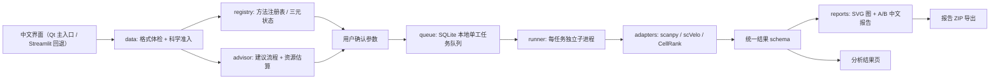

# CellFlow：架构与 MVP 范围

> 注（2026-10-25）：本文是早期 MVP 规划稿，“Streamlit 界面”指的是当时的回退入口。
> 当前**唯一默认入口**是 Qt 原生窗口（`cellflow_app.pyw` + `web/` 前端）；实际结构以 [architecture.md](architecture.md) 为准。

目标用户：希望用中文图形界面做探索性分析、但不熟悉 Python 环境管理的研究者。
设计优先级：**输入与方法条件说清楚 → 失败可解释 → 运行可追溯 → 不编造生物学故事**。

---

## 1. 页面与数据流

页面顺序（当前实现）：**概览 → 数据 → 模型分析 → 分析结果 → 报告**。
（早期规划稿使用的是「操作手册 → 模型介绍 → 开始分析 → 任务结果」这一组旧名。）



关键解耦：

- **说明页面不计算**：操作手册与模型介绍只读本地内容，不导入数据、不写 `results/`、不创建任务（有测试保证）。
- **界面与计算通过文件 + 队列解耦**：页面刷新不会启动重复训练；每个任务一个子进程，互不共享内存与图对象。
- **每个方法都在输入副本上重新预处理**：不复用另一个方法留下的邻域、速度或潜时间。

---

## 2. 模块职责

| 文件 | 职责 | 是否含科学判断 |
|---|---|---|
| `cellflow/registry.py` | 方法清单、用途分层、输入前提、依赖、三元状态（可运行/实验接入/尚未接入）、准入函数 | 是（准入规则） |
| `cellflow/data.py` | 读取 `.h5ad`/`.npz`、格式体检 `inspect()`、科学准入 `validate()`、质控指标 | 是（前提判定） |
| `cellflow/advisor.py` | 按数据事实推荐流程、粗算内存/耗时、给保守参数 | 是（规则，不自动执行） |
| `cellflow/runner.py` | 单任务编排：复制输入、快照环境与源码、写日志、调用适配器、生成报告 | 少量 |
| `cellflow/queue.py` | SQLite 队列、单 worker、每任务子进程 | 否 |
| `cellflow/adapters.py` | 真实调用上游模型，转换成统一结果 schema | 是（模型实现） |
| `cellflow/reports.py` | SVG 图形、A 生物学报告、B 技术复现报告 | 否（只呈现） |
| `cellflow/trends.py` | 沿时间/排序的探索性分箱趋势 | 是（描述性统计） |
| `cellflow/compare.py` | 两个任务的**可比性检查**与配对方向一致性 | 是（比较契约） |
| `cellflow/method_content.py` | 模型介绍的中文内容（纯数据） | 否 |
| `cellflow/ui_theme.py` | 设计系统（颜色、徽章、卡片、流程条） | 否 |
| `cellflow/ui_*.py` | 四个页面 | 否 |
| `tools/build_method_docs.py` | 从注册表+内容生成离线版模型介绍 | 否 |

---

## 3. 统一结果 schema（所有适配器共用的字段）

```
method, synthetic, cells_hash, genes_hash,
embedding, embedding_name, embedding_basis,
time, time_name,              # 时间/排序字段及其口径（必须写清是不是真实时间）
metrics, gene_table, caveats, evidence, effective,
velocity, arrows, preprocessing_hash,
groups{key,labels,sizes},     # 分群（Leiden / PAGA / CellRank 共用）
paga{groups,connectivities,direction_hint},
fate{terminal_states,probabilities,terminal_state_stats,early_terminal_states,drivers,...},
gene_trends                   # runner 追加
```

约定：**没有算出来的东西就不写**；每个方法都必须给出 `caveats`（中文解释边界）与 `evidence`（证据来源）。

---

## 4. 方法接入的“四道门”

一个新方法从“注册”到“可运行”必须依次通过：

1. **输入契约**：声明必需/可选输入，并在 `data.validate()` 里有对应检查（缺什么、为什么缺）。
2. **真实调用**：适配器调用上游库的真实函数，参数写进 `calls.json`，版本写进 `environment.json`。
3. **输出转换**：把结果映射到统一 schema，并明确 `we_not_output`（不产出的东西）。
4. **测试**：契约测试 + 至少一次端到端运行 + 报告断言；失败路径也要有测试（必须“明确失败”而不是假成功）。

只安装包、不写适配器、不跑测试 → 状态最多是「尚未接入」或「实验接入」。

---

## 5. 本期范围（MVP+）

| 能力 | 已实现 | 明确边界 |
|---|---|---|
| 输入 | `.h5ad`；内置非 pickle 的 `.npz` 教学数据 | 不处理 FASTQ/BAM/RDS/CSV；上传 ≤1024 MiB、本机文件 ≤4 GB、矩阵合计内存 ≤3 GB |
| 格式体检 | 维度、dtype、稀疏度、整数外观、非零比例、层、obs 候选列、基因 ID 类型、线粒体命中、剪接覆盖率 | 数值外观不能证明文库类型或比对质量 |
| 质控 | 总表达、检测基因数、线粒体比例、剪接比例、复杂度、PCA | 不套通用阈值删细胞；不做双细胞/环境 RNA 校正 |
| 分群 | Leiden（igraph 后端）+ UMAP | 群不是细胞类型；参数改变会改变群 |
| 轨迹 | DPT（需起点+依据）、PAGA（支持自动分群，可选方向线索） | 拟时序不是真实时间；PAGA 无向 |
| 速度 | scVelo stochastic / dynamical（速度、伪时序/latent time、一致性诊断、基因参数） | 箭头不是谱系证据；不同模型损失不可比 |
| 命运 | CellRank 2（PseudotimeKernel + GPCCA） | 终末状态需生物学确认；>6000 细胞拒绝；早端终末状态自动告警 |
| 执行 | 持久化队列、单任务并发、每方法子进程、输入副本、环境/源码快照、真实调用记录 | 无训练取消、无崩溃续训、无严格内存隔离 |
| 输出 | 统一 schema、SVG + 可交互 Plotly、A/B 中文报告、可打印 HTML、ZIP | 无原生 Word/PDF 排版 |
| 比较 | 输入/代码/依赖/预处理/种子一致才允许比较，只报配对方向一致性 | 不给“最佳模型”，不比较似然/损失/潜时间 |

---

## 6. 环境策略

1. **主环境 `.venv`**：Python 3.11、Streamlit、Plotly、AnnData、Scanpy、scVelo、igraph；
   可选 **CellRank 2.0.7**（CPU、体积小，直接装主环境）。
2. **`.venv-regvelo`**（可选、未安装）：RegVelo 0.4.2 + CPU PyTorch 2.5.1 + scvi-tools 1.2.0，避免与主环境互相污染。
3. **未来独立环境**：veloVI、UniTVelo、DeepVelo、VeloAE、dynamo、MultiVelo 各自的版本约束差异大，需逐项复现官方示例。

不自动安装 CUDA / NVIDIA 驱动；默认 1 线程计算，避免 16 GB 机器内存被同时占满。

---

## 7. 泄漏防护与公平比较（写在代码里的约束）

- 探索性全量拟合 与 正式预测评测 分开；本程序只做前者，并明确声明不提供泛化性能。
- 正式评测需按供体/样本预先拆分；HVG、GRN、调参、早停只能用训练数据。
- 根节点/终末状态若来自实验时间，就不能再用同一标签做独立验证。
- `compare.py` 会检查：输入 SHA-256、代码哈希、关键依赖版本、细胞/基因哈希、预处理指纹、随机与预处理配置；
  任一项不一致 → 直接判“不可比较”并列出原因。

---

## 9. 模型切换、设备与隔离环境（新增）

```
用户选模型 ──► VELOCITY_MODELS（registry）──► 具体方法 key
                                              │
                             ┌────────────────┴────────────────┐
                             ▼                                 ▼
                    主环境 .venv（scanpy/scVelo/CellRank）   隔离环境（veloVI / RegVelo）
                             │                                 │
                             └──────── queue.submit 按 runtime_env 选解释器 ──► 子进程
```

- `cellflow/device.py`：把「设备」变成一等配置（auto/cpu/cuda + 环境变量），
  神经网络方法真正使用 GPU，非神经网络方法如实说明“选 GPU 也不会更快”。
- `cellflow/importers.py`：把「格式」变成程序问题而不是用户问题；
  所有格式统一成 Dataset（cells × genes），下游方法零改动。
- `cellflow/publicdata.py`：公开数据下载（GEO / CELLxGENE / URL），转换后同样进入 Dataset。
- 隔离环境用 `registry.env_python()` 一处判断，界面/队列/测试共用，避免每个模型写一遍 if。

---

## 8. 下一步优先事项

1. 用一个真实小样本（有 spliced/unspliced）走通全流程，检查相图、剪接覆盖与参数敏感性。
2. RegVelo：安装独立 CPU 环境并**实际训练**一次，验证 `set_prior_grn` 与 GRN 覆盖率的真实行为。
3. 接入 veloVI（独立 scvi-tools 环境），保存后验不确定性；再做 CellRank 的 VelocityKernel 版本。
4. 增加样本表、基因 ID 映射、批次与混杂检查，以及多种子/参数敏感性分析。
5. 大数据：backed/Zarr 读取、内存预估、任务取消与断点续训、并发限额。
